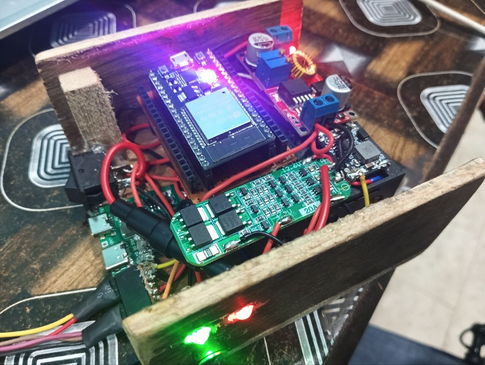

# Laser Turret — Power Supply


**Two clean 5 V rails, one common ground, and not a single servo amp through the logic.**

This is the power supply built for the laser turret: a 3-cell pack with a BMS and charger feeding two independent buck converters. One rail runs the ESP32 and Blue Pill logic; the other runs the two servos and the laser. A 5-pin header carries power and the UART link out to the turret.

The turret firmware, simulator and control notes live in the separate
[forgeVII/laser_turret](https://github.com/forgeVII/laser_turret) repo.

---

## Demo

[](https://youtube.com/shorts/UFWoeOp6Qgk)
The turret and this PSU in the merged working + build short.

---

## Build Photos

| Photo | Description |
|---|---|
|  | PSU box — both rails, header and pack |

More close-ups are reserved in `MEDIA.md`.

---

## Overview

| Property | Value |
|---|---|
| **Input** | 3-cell battery pack with BMS + charger |
| **Logic rail** | Fixed 5 V — MP1584 |
| **Actuator rail** | Variable 5 V, CC 2.0 A — XL4015 |
| **Logic load** | ESP32 bridge + STM32 Blue Pill |
| **Actuator load** | 2× SG90 servo + 5 V TTL laser |
| **Ground** | Single common GND across both rails |
| **Interface** | 5-pin header — 2 power, 2 UART, 1 GND |

---

## Power Tree

```
3-cell pack
  -> BMS + charger
  -> MP1584 (fixed 5 V)   -> ESP32 + Blue Pill logic
  -> XL4015 (5 V, CC 2 A) -> 2x SG90 servo + laser
                     one shared GND
```

### 5-Pin Header

| Pin | Signal |
|---|---|
| 1 | Fixed 5 V (logic) |
| 2 | Variable 5 V (actuators) |
| 3 | ESP32 TX |
| 4 | ESP32 RX |
| 5 | GND |

---

## Safety — Short Version

- Never power the whole turret from STM32 USB (measured 4.80 V, ~0.7 A).
- Never feed Blue Pill 5 V from the PSU and USB/ST-Link at the same time.
- No servo current through the Blue Pill 5 V pin.
- Logic on MP1584, actuators on XL4015, one common ground.

Full detail, including the EN-pin POR fix and header map, is in `PSU.md`.

---

## Bring-Up Notes

The build had two real faults, both documented in `BUILD_NOTES.md`:

- **EN pin at power-on** — the ESP32 needed EN held HIGH after the rail settled. Fixed with a 10 kΩ EN→3.3 V pull-up plus 100 nF EN→GND (Espressif POR RC). OTA reboots were fine because the chip was already running.
- **SD1/SD0 short and bad GND** — caused `invalid header: 0x00000000` and an RTCWDT reset loop. Fixed physically by separating SD1/SD0 and using a working GND.

Both were hardware fixes — firmware cannot recover either.

---

## Docs

| File | Contents |
|---|---|
| `PSU.md` | Canonical as-built doc — rails, header map, wiring, power budget, safety rules |
| `BUILD_NOTES.md` | Physical faults found and fixed, bring-up and flashing gotchas |
| `MEDIA.md` | Photo and video slots, demo links |
| `LICENSE` | MIT |

---

## Project Structure

```
laser_turret_psu/
├── media/photos/       # build photos
├── BUILD_NOTES.md
├── MEDIA.md
├── PSU.md
├── LICENSE
└── README.md
```

---

## Built By

Harish Chand — `forgeVII`. Personal build: learning, experimenting, shipping.

---

## License

MIT License — use freely, build your own, share what you make.
